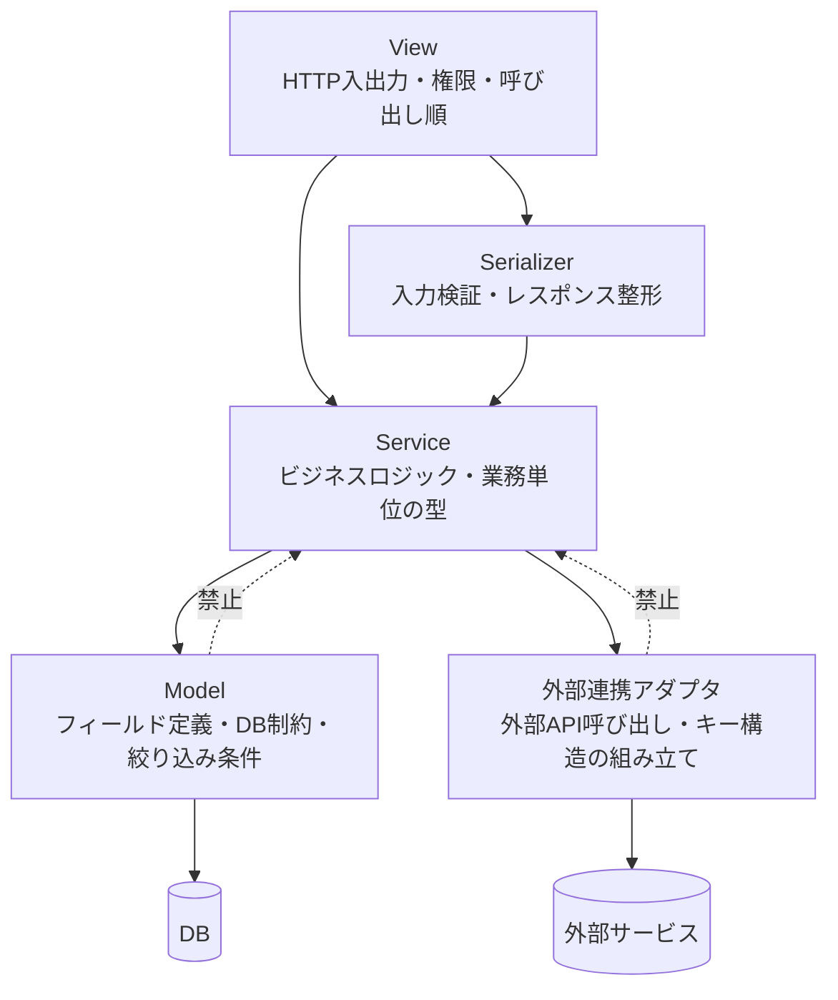

# Django実装reference

このreferenceを読む前に、まず`references/common/api-design.md`を読むこと。
共通原則（**契約**の明示、型設計、docstring）は共通referenceに集約している。

## 実装原則

### 原則：ビジネスロジックはServiceに置く

判定、状態遷移、複数モデルの読み書き、外部サービスへ渡す値の決定は、すべてServiceに置く。
ModelとSerializer、Viewにはビジネスロジックを書かず、Serviceを呼び出す側に回す。
Serviceに集約しておけば、HTTPの入口やDBの構造を読まなくても業務の流れを追えるうえ、後からの改修も1か所で済む。

| 層 | 置くもの | 置かないもの |
| --- | --- | --- |
| View | HTTPの入出力、権限、Serviceの呼び出し順 | 判定や状態遷移 |
| Serializer | 入力の検証、レスポンス用の整形 | 「〜とみなす」といった業務上の判定 |
| Service | ビジネスロジック、業務単位の型（TypedDictやdataclass） | HTTPの都合、外部APIのキー構造 |
| Model | フィールド定義、DB制約、再利用する絞り込み条件の名前付け | 業務上の判定、複数モデルへの書き込み |
| 外部連携アダプタ | 外部APIの呼び出し、外部APIが要求するキー構造の組み立て | 渡す値の決定 |

依存は View / Serializer → Service → Model / 外部連携アダプタ の一方通行にする。



ModelからServiceをimportしたくなったら、そのロジックの置き場がModel側に寄りすぎているので、Serviceへ戻す。

引数をほぼそのまま`objects.create()`へ渡すだけのclassmethodをModelに作らない。
切り出す利点がなく、Modelに書き込み操作を集約する方針でもないため、呼び出し側のServiceで直接`create()`する。
「追記専用で更新しない」といった制約は、メソッドで表現するのではなくModelクラスのdocstringに書く。

既存コードは即時に移動せず、新規追加分から原則を適用する。
既存の構成でModel側に関数群がまとまっている場合（ログ作成関数など）は、その構成に合わせてよい。

### 原則：ViewはSerializerの公開APIだけを参照する

Viewから参照してよいのは`validated_data`、`save()`の戻り値、`data`、`instance`、`context`だけである。
`validate()`や`create()`内で設定したカスタム属性をViewから読まない。
保存前は`validated_data`、保存後は`save()`の戻り値を使う。

| 参照したいもの | 使うもの | タイミング |
| --- | --- | --- |
| 検証済みの入力 | `serializer.validated_data` | `is_valid()`の後 |
| 保存後のモデル | `serializer.save()`の戻り値 | `save()`の後 |
| レスポンス用の表現 | `serializer.data` | レスポンス生成時 |
| Viewから渡した追加情報 | `serializer.context` | Serializer内部 |

```python
# ❌ ViewがSerializerのカスタム属性へ依存する
class OrderSerializer(serializers.ModelSerializer):
    def validate(self, attrs):
        self.calculated_total = compute_total(attrs)
        return attrs


serializer.is_valid(raise_exception=True)
serializer.save()
notify_billing(serializer.calculated_total)
```

```python
class OrderSerializer(serializers.ModelSerializer):
    def validate(self, attrs):
        attrs["total"] = compute_total(attrs)
        return attrs

    def create(self, validated_data):
        return Order.objects.create(**validated_data)


serializer.is_valid(raise_exception=True)
total = serializer.validated_data["total"]
order = serializer.save(created_by=request.user)
send_confirmation(order)
return Response(self.get_serializer(order).data, status=status.HTTP_201_CREATED)
```

### 原則：Serviceモジュールは業務の単位で切る

ViewやSerializerはURLやリソースごとにモジュールを分けるが、Serviceはその構造に合わせて1:1で分ける必要がない。
Serviceが表すのは業務ロジックであり、HTTPの入口とは別の単位で読まれるからである。
関連する業務を扱う小さなモジュールが複数あるなら、1つにまとめる。
逆に、1つのモジュールが複数の業務を抱えて肥大化したら、業務の境界で分ける。

### 原則：外部連携アダプタはServiceと分ける

外部サービスのAPIを呼ぶクライアントクラスは、Serviceとは別のモジュールに置く。
アダプタが担うのは外部APIの呼び出しと、外部APIが要求するキー構造の組み立てである。
どの値を渡すかはServiceが決める。キー構造は外部側の制約であり、値の決定は業務上の判断だからである。
アダプタ側でキー構造をTypedDictとして定義し、Serviceはその型の値を組み立てて渡す形にすると境界がはっきりする。

クライアントクラスは、公開メソッドがエンドポイントごとに増えていく。
そこへパラメータの組み立てまでプライベートメソッドで足していくと、クラスが1つの責務に収まらなくなる。
組み立ては専用のクラス（`_XxxParamsBuilder`など）に切り出し、クライアントクラスはそのクラスへ委譲する。
状態を持たないなら`classmethod`や`staticmethod`だけのクラスでよく、dataclassにする必要はない。

## フェーズ別のDjango固有事項

進行順序は`SKILL.md`の「実装フロー」に従う。ここには各フェーズでDjango/DRFに固有の判断とコード例だけを書く。

### 仕様確認

`required`とoptionalの境界をOpenAPIと一致させる。

### モデル設計

フィールド定義とDB制約を決める。
再利用する絞り込み条件があればCustomManagerやCustomQuerySetに名前を付ける。
詳細は`references/django/orm.md`を参照する。

### Serializer設計

共通原則（契約の明示）に従う。
ほぼ全て**ModelSerializer**を基本とする。
OpenAPIとフィールド名、`required`、`enum`、`format`を一致させる。
`required=True`で保証される入力は`validated_data["field"]`で読む。
Viewから追加文脈が必要なら`get_serializer_context()`を使う。
書き込み可能なNested Serializerは`create()`または`update()`の実装要否を確認する。

```python
class UserSerializer(serializers.ModelSerializer[User]):
    class Meta:
        model = User
        fields = ["id", "username", "email", "full_name", "is_active"]
        read_only_fields = ["id"]
```

```python
class UserViewSet(viewsets.ModelViewSet):
    def get_serializer_context(self) -> dict:
        context = super().get_serializer_context()
        context["requested_by"] = self.request.user
        return context
```

### PermissionとAuthentication

`permission_classes`をViewSetへ明示する。
アクションごとに異なる権限が必要なら`get_permissions()`を使う。
レート制限やセキュリティ詳細は`references/django/nfr.md`を参照する。

| シナリオ | Throttle |
| --- | --- |
| 未認証 | `AnonRateThrottle` |
| 認証済み | `UserRateThrottle` |
| 特定エンドポイント | `ScopedRateThrottle` |

```python
class IsOwnerOrReadOnly(permissions.BasePermission):
    def has_object_permission(self, request, view, obj: User) -> bool:
        if request.method in permissions.SAFE_METHODS:
            return True
        return obj.owner == request.user
```

### ViewとViewSet実装

`queryset`に適切なeager loadingを入れる。
`get_queryset()`でテナントやユーザー絞り込みを行う。
`perform_create()`でリクエスト依存の保存情報を渡す。

| 用途 | クラス | ViewSet相当 |
| --- | --- | --- |
| 一覧と作成 | `ListCreateAPIView` | `ModelViewSet` |
| 取得と更新と削除 | `RetrieveUpdateDestroyAPIView` | `ModelViewSet` |
| フルCRUD | - | `ModelViewSet` |

```python
class UserViewSet(viewsets.ModelViewSet):
    queryset = User.objects.select_related("profile")
    serializer_class = UserSerializer
    permission_classes = [IsAuthenticated]

    def get_queryset(self) -> QuerySet:
        return self.queryset.filter(tenant=self.request.user.tenant)

    def perform_create(self, serializer) -> None:
        serializer.save(created_by=self.request.user)
```

保存前の入力参照は`validated_data`を使う。
保存結果が必要な処理は`instance = serializer.save(...)`の戻り値を使う。
ViewからSerializerのカスタム属性を読まない。

### URLルーティング

Routerと`basename`を明示する。

```python
router = SimpleRouter()
router.register(r"users", UserViewSet, basename="user")

urlpatterns = [path("", include(router.urls))]
```

### テスト

APIテストの最小構成を用意する。
詳細は`references/django/testing.md`を参照する。

```python
class UserListAPITests(TestCase):
    def setUp(self) -> None:
        self.client = APIClient()
        self.user = UserFactory(is_admin=True)
        self.client.force_authenticate(user=self.user)

    def test_list_returns_users_with_valid_auth(self) -> None:
        UserFactory.create_batch(3)
        response = self.client.get("/api/users/")
        self.assertEqual(response.status_code, 200)
```

### パフォーマンス

ORM最適化の詳細は`references/django/orm.md`を参照する。
ログとレート制限、設定は`references/django/nfr.md`を参照する。

### レビュー

本referenceの「レビュー観点」と`references/django/nfr.md`の「確認チェックリスト」で確認する。

## Adminクラスのdocstring

`ModelAdmin`の説明は、クラス変数やメソッドごとに分散させず、クラスのdocstringに集約する。
表示項目、権限、アクションの見出しで分け、読み手が1か所で全体を把握できるようにする。
アクションの詳細だけは、アクションメソッド側のdocstringに書いてよい。

```python
class FooAdmin(admin.ModelAdmin):
    """Fooの管理画面

    ## 表示項目
    一覧、検索、ソートの対象

    ## 権限
    追加、編集、削除の可否と条件

    ## アクション
    提供するアクションの一覧（詳細は各メソッド）
    """
```

## レビュー観点

- ビジネスロジックがServiceに集約され、ModelやSerializer、Viewに判定が残っていないか
- ModelからServiceをimportしていないか
- 外部連携アダプタに値の決定が入り込んでいないか
- モジュール間で受け渡すdictにTypedDictまたはdataclassが付いているか
- Serviceモジュールの分割が業務の単位になっているか（ViewやSerializerと1:1に分けただけになっていないか）
- 外部APIクライアントのクラスにパラメータ組み立てのプライベートメソッドが増えていないか
- パス操作に`os.path`を新たに使っていないか
- 不在を空のdictやlistでなく`None`で返しているか
- 引数にデフォルト値を付けていないか
- 不要な`get()`や`getattr(..., default)`がないか
- ViewとSerializerの責務境界が崩れていないか
- 保存前に`serializer.data`やSerializerのカスタム属性を参照していないか
- `serializer.save()`後に必要な値を戻り値または`instance`から受けているか
- 認証認可テストがあるか
- N+1がないか
- 変更の主題と無関係な差分が混ざっていないか
- 静的解析とテストが通っているか
- 追加した処理にdocstringが必要か確認し、既存規約に合わせているか

## トラブルシューティング

### Permission Deniedでテストが失敗する

1. `force_authenticate()`を呼んでいるか
2. `permission_classes`が正しいか
3. ユーザーのroleやgroupが十分か

### POSTで403になる

1. `permission_classes`とテストユーザーの権限を確認する
2. 認証方式とCSRF前提を確認する

## 参考資料

- [DRF公式ドキュメント](https://www.django-rest-framework.org/)
- [drf-spectacular](https://drf-spectacular.readthedocs.io/)
- [OpenAPI3.0仕様](https://swagger.io/specification/)
